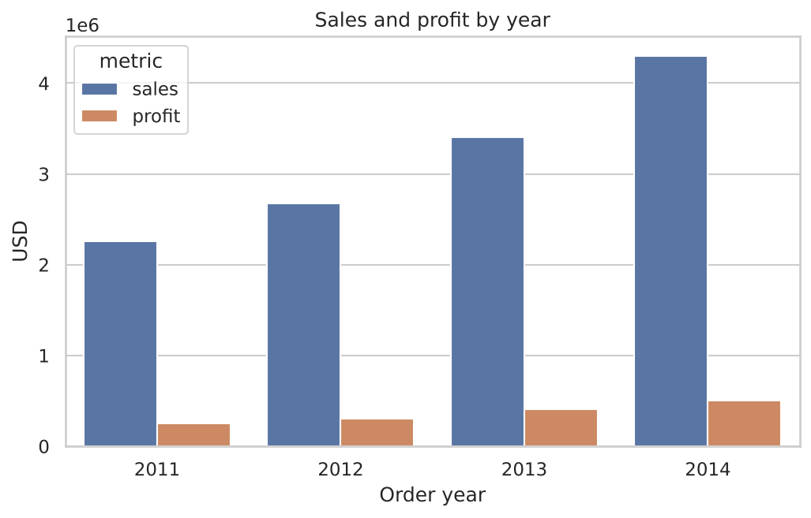
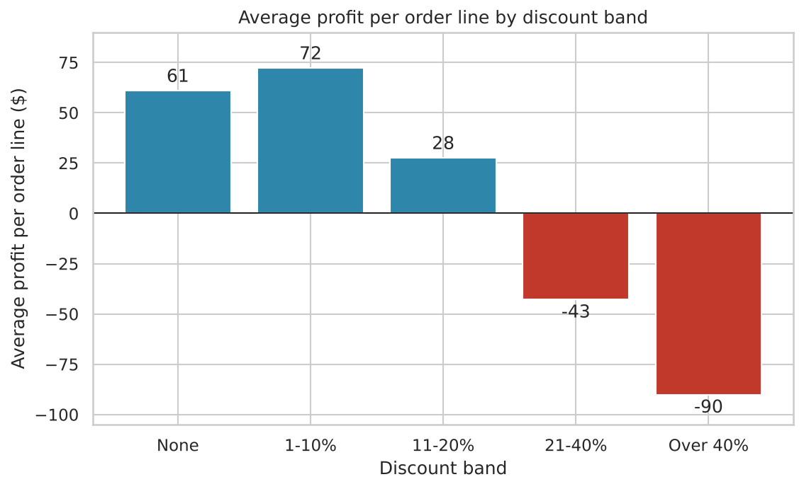
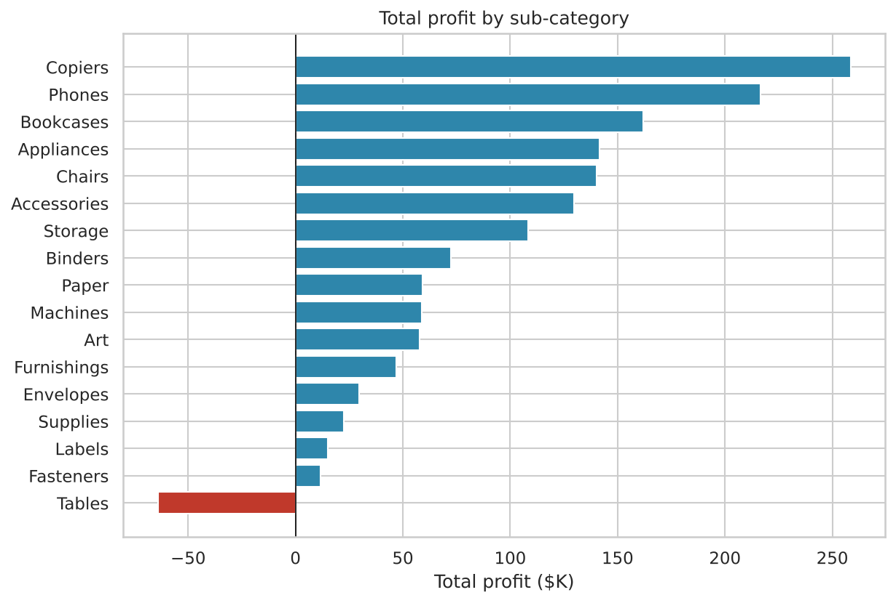

# Global Retail Sales Analysis: Are We Growing Profitably?

[](https://colab.research.google.com/github/Nidhiwa/retail-sales-analysis/blob/main/retail_sales_analysis.ipynb)

An exploratory analysis of 51,290 order lines (2011 to 2014) from a global retailer, built around one business question from a VP of Sales:

> *"Sales have grown every year, but I am not sure we are growing profitably. Where do we make money, where do we lose it, and what should we change?"*

**Notebook:** [`retail_sales_analysis.ipynb`](retail_sales_analysis.ipynb)
**Tools:** Python, pandas, Matplotlib, Seaborn, Plotly Express

## Key findings

| # | Finding | Evidence in the notebook |
|---|---|---|
| 1 | **Sales and profit both grew, but the margin stayed flat**
| 2 | **Profit per order line turns negative once discounts pass 20%** 
| 3 | **Tables is the only loss-making sub-category** 
| 4 | **EMEA earns a 5.4% margin** 
| 5 | **Furniture earns half the margin of the other categories** 
| 6 | **Southeast Asia is the lowest-margin region** 







## What the notebook covers

1. Load and inspect the data (encoding issue, missing values, duplicates)
2. Clean and prepare (date parsing for mixed formats, derived columns, cleaning log, sanity checks)
3. Summary tables (yearly, category, market)
4. Sales and profit by year
5. Margin by category and market, profit by market and category, profit by sub-category
6. Profit by discount band, market and region checks, correlation between numeric columns
7. Monthly sales with a 3-month rolling average, and monthly sales by market
8. Interactive Plotly charts

## Run it yourself

**In Google Colab:** click the badge at the top (after replacing `YOUR-USERNAME` in the link).

**Locally:**

```bash
git clone https://github.com/Nidhiwa/retail-sales-analysis.git
cd retail-sales-analysis
pip install -r requirements.txt
jupyter notebook retail_sales_analysis.ipynb
```

The notebook downloads the dataset from a public URL, so no data file is needed.

> The two Plotly charts are interactive. GitHub shows them blank inside notebooks, so open the notebook in Colab or [nbviewer](https://nbviewer.org/) to use them.

## Data

"Global Superstore" sample dataset (fictional), loaded from [pplonski/datasets-for-start](https://github.com/pplonski/datasets-for-start).

## Limitations

- The data is fictional, so the results demonstrate the method rather than describe a real company.
- Discount and profit are negatively related (correlation -0.32), but this analysis does not prove that discounts cause the losses or explain the EMEA and Tables results.
- The dataset has no cost or sales-channel fields, which limits explanations for margin differences.
